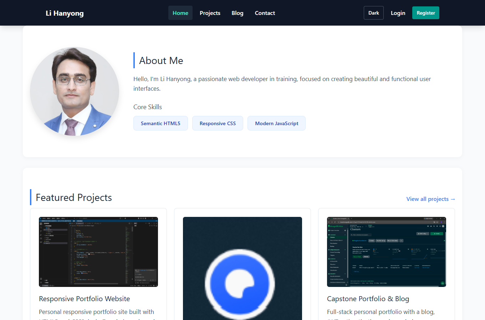
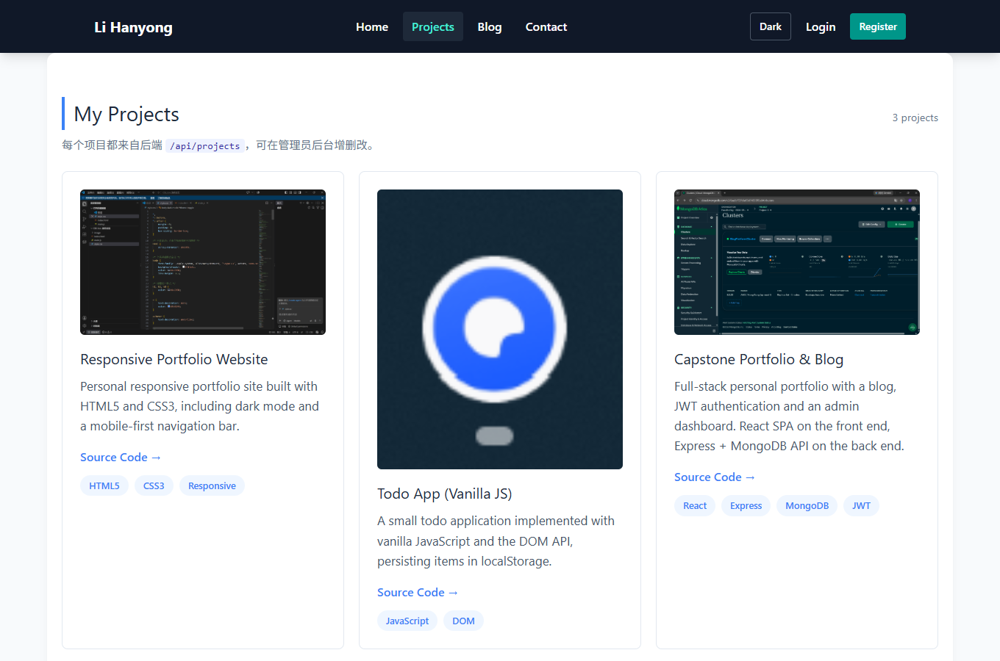
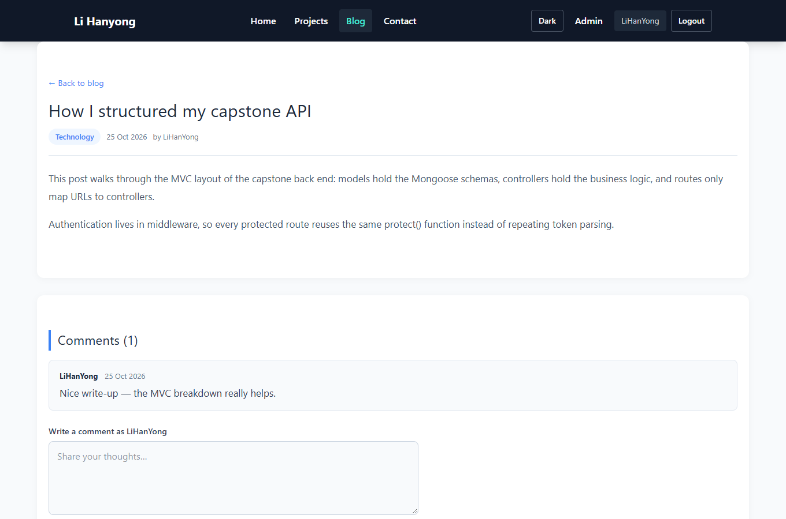
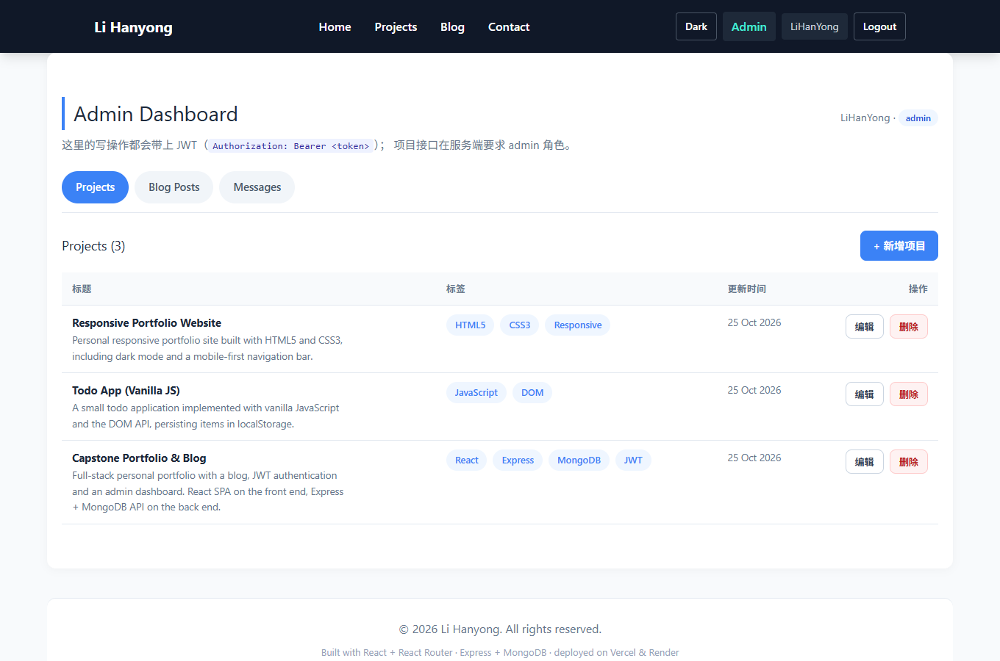

# Capstone Project — Full-Stack Portfolio & Blog

> 中文摘要：期末作品是一个全栈「个人作品集 + 博客」网站。后端 Node.js + Express + MongoDB Atlas 提供 RESTful API（JWT 认证、5 个模型、14 个接口）；前端 React + React Router 提供 7 条路由、受保护的 `/admin` 后台管理面板。源码分为 `server/` 与 `client/` 两个目录，前后端分别部署。

## Live URLs

| | URL |
|---|---|
| Front-End (SPA) | https://capstone-client-phi.vercel.app |
| Back-End (API) | https://capstone-portfolio-zeta.vercel.app |
| API health check | https://capstone-portfolio-zeta.vercel.app/api/health |

## Screenshots

| Home | Projects |
|---|---|
|  |  |

| Blog post + comments | Admin dashboard |
|---|---|
|  |  |

Dark mode: [`docs/screenshots/06-dark-mode.png`](docs/screenshots/06-dark-mode.png)

## Tech stack

| Layer | Stack |
|---|---|
| Back-End | Node.js · Express 5 · Mongoose 9 · MongoDB Atlas |
| Auth | bcrypt (password hashing) · JSON Web Token |
| Security | helmet · cors · dotenv |
| Front-End | React 19 · React Router 7 · Vite 8 · Tailwind CSS 4 |
| Deploy | Render (API) · Vercel / Netlify (SPA) |

## Project structure

```
capstone/
├── README.md                  ← this file
├── server/                    Node.js + Express API
│   ├── config/db.js            Mongoose connection
│   ├── models/                 User, Project, BlogPost, Comment, Message
│   ├── controllers/            business logic (MVC "C")
│   ├── routes/                 URL → controller mapping
│   ├── middleware/             authMiddleware (protect / requireAdmin), errorMiddleware
│   ├── utils/                  ErrorHandler, generateToken
│   ├── scripts/                seed.js, makeAdmin.js
│   ├── tests/                  automated API + lab regression tests
│   ├── API.md                  full endpoint reference
│   └── server.js               app wiring
└── client/                    React SPA
    ├── src/api/client.js       single fetch wrapper (adds Bearer token)
    ├── src/context/            AuthContext (login state, Context API)
    ├── src/components/         Header, Footer, ProtectedRoute, cards, forms
    ├── src/pages/              Home, Projects, Blog, BlogDetail, Contact, Login, Register, Admin, 404
    └── src/index.css           design system + dark mode
```

## Run locally

### 1. Back-End

```bash
cd server
npm install
cp .env.example .env      # then fill MONGO_URI and JWT_SECRET
npm run seed              # optional: requires SEED_ADMIN_EMAIL in .env
npm run dev               # http://localhost:5000
```

Environment variables (`server/.env`):

| Key | Required | Notes |
|---|---|---|
| `MONGO_URI` | yes | MongoDB Atlas connection string |
| `JWT_SECRET` | yes | any long random string |
| `JWT_EXPIRES_IN` | no | default `30d` |
| `PORT` | no | default `5000` |
| `CORS_ORIGIN` | no | comma-separated front-end origins; empty = allow all (dev only) |
| `SEED_ADMIN_EMAIL` / `SEED_ADMIN_USERNAME` / `SEED_ADMIN_PASSWORD` | no | used by `npm run seed` |

### 2. Front-End

```bash
cd client
npm install
cp .env.example .env.local     # VITE_API_URL=http://127.0.0.1:5000
npm run dev                    # http://localhost:5173
```

Build for production: `npm run build` → output in `dist/`.

### 3. Admin account

Project management is admin-only. Register an account on the site, then promote it:

```bash
cd server
npm run make-admin -- you@example.com            # promote only
npm run make-admin -- you@example.com NewPass123 # promote + reset password
```

Log in with that account → the header shows an **Admin** link → `/admin` dashboard.

## API endpoints

Full reference with request/response examples: [`server/API.md`](server/API.md).
Base URL locally: `http://localhost:5000`.

| Method | Endpoint | Auth | Description |
|---|---|---|---|
| POST | `/api/users/register` | public | Register (bcrypt hashed password) |
| POST | `/api/users/login` | public | Login, returns JWT |
| GET | `/api/projects` | public | All portfolio projects |
| GET | `/api/projects/:id` | public | Single project |
| POST | `/api/projects` | admin | Create project |
| PUT | `/api/projects/:id` | admin | Update project |
| DELETE | `/api/projects/:id` | admin | Delete project |
| POST | `/api/contact` | public | Save a contact message |
| GET | `/api/blog` | public | All posts (author populated) |
| GET | `/api/blog/:id` | public | Post + author + comments |
| POST | `/api/blog` | JWT | Create post |
| PUT | `/api/blog/:id` | author / admin | Update post |
| DELETE | `/api/blog/:id` | author / admin | Delete post (+ its comments) |
| GET | `/api/blog/:postId/comments` | public | Comments of a post |
| POST | `/api/blog/:postId/comments` | JWT | Add a comment |
| GET | `/api/contact` | admin | Message inbox |
| DELETE | `/api/contact/:id` | admin | Delete a message |
| GET | `/api/health` | public | Health check (DB state) |

`/api/posts` is kept as an alias of `/api/blog` for backwards compatibility with the lab exercises.

## Features checklist

**Back-End**
- [x] MVC layout (`models` / `routes` / `controllers`)
- [x] MongoDB Atlas + Mongoose schemas with validation (User, Project, BlogPost, Comment, Message)
- [x] bcrypt password hashing, JWT login, `protect` middleware
- [x] Author-only update/delete for blog posts, admin-only project management
- [x] `populate()` for author names and comments
- [x] Centralised error handler + 404 fallback (consistent JSON)
- [x] helmet, cors, dotenv
- [x] Deployed API

**Front-End**
- [x] Component-based React with reusable `ProjectCard`, `BlogCard`, `CommentSection`, forms
- [x] React Router routes: `/`, `/projects`, `/blog`, `/blog/:id`, `/contact`, `/login`, `/register`, `/admin` (protected)
- [x] `useState` + `useEffect` for data fetching, loading / error / empty states
- [x] Context API for authentication state, auth-aware header
- [x] Controlled forms (contact, login, register, comment, admin CRUD)
- [x] Protected admin dashboard: create / update / delete projects and posts, message inbox
- [x] Responsive layout + dark mode (Tailwind CSS v4 + custom CSS)

## Automated checks

```bash
cd server
npm run test:capstone     # 49 assertions over all 14 endpoints (needs the API running locally)
npm run test:auth         # lab regression: JWT protection
npm run test:owner        # lab regression: author ownership
node tests/prod-check.js  # 18 assertions against the deployed Vercel API
```

## Deploying (two Vercel projects, one repository)

The API runs as a Vercel Serverless Function (`server/api/index.js` wraps the Express app,
and `server/vercel.json` routes every request into it), so no separate server host is needed.

**1. API project — root directory `server`**
1. Vercel → Add New → Project → import this repository
2. Root Directory: `server` · Framework Preset: Other
3. Environment variables:
   `MONGO_URI`, `JWT_SECRET`, `NODE_ENV=production`, `CORS_ORIGIN=https://<client-domain>`
4. Deploy, then verify `https://<api>.vercel.app/api/health` → `"db":"connected"`

**2. Client project — root directory `client`**
1. Same repository, second project · Root Directory: `client` · Framework Preset: Vite
2. Build `npm run build` · Output `dist`
3. Environment variable: `VITE_API_URL=https://<api>.vercel.app`
4. Deploy (`client/vercel.json` already rewrites deep links such as `/blog/:id` to `/index.html`)

> Alternative hosts (Render, Railway, Fly.io) work too: point them at `server/`,
> build with `npm install`, start with `npm start`. Note Render and Heroku now require a
> verified payment method even on their free/entry tiers.

## Notes

- `.env` files are **not** committed and **must be excluded** from the submitted ZIP.
- `node_modules` and `dist` are excluded from the ZIP as well.
- The images under `client/public/image` come from earlier lab exercises; swap them for your own screenshots if you like.
